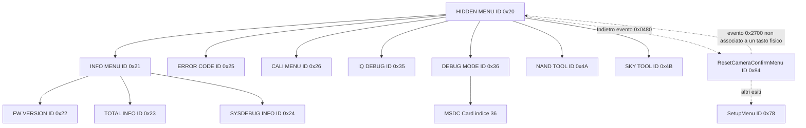

# Mappa dettagliata HiddenMenu dalle fotografie e dai documenti

**Continuazione persistenza — 20 ottobre 2026:** [nuova ricerca](S33_HiddenMenu_Persistenza_MSDC_e_Inizializzazione_USB.md): resetOFF aggiuntivo aC5EEC, descrittori PTP/MSC collegati al selettore durante inizializzazione, guardia e interprete; 24setterRAM eBatGauge chiariti. Le precedenti formulazioni sul solo reset condizionale o sull’etichettaMSDC sono incomplete rispetto a questo checkpoint. Nessun salvataggio globale o massstoragehardware nuovo dimostrato.

20 ottobre 2026 — inventario locale delle immagini in `immagini/`, delle 23 fotografie archiviate e della mappa statica V1.1. Questa guida dice **quali schermate sono state viste**, come appartengono all'albero HiddenMenu e quali rami sono da non selezionare. Non abilita comandi sulla fotocamera, non prova la persistenza delle opzioni e non sostituisce la [mappa tecnica completa](HIDDENMENU_MAP.md).

## Risultato principale

Le fotografie mostrano che il menu nascosto viene renderizzato sulla COOLPIX S33 e che sono navigabili almeno INFO, SKY, NAND, DEBUG, IQDEBUG, CALIBRATION ed ERROR CODE. L'albero radice ha sette voci. Le foto coprono sei delle sette: manca solo la schermata radice **HIDDEN MENU** stessa, mentre INFO.MENU ne è il primo ramo. Nessuna foto mostra `ResetCameraConfirmMenu` o la scelta visibile che genera l'evento `0x2700`.

Le voci visibili non sono tutte letture innocue. NAND TOOL contiene operazioni candidate di scrittura flash e formattazione; SKY TOOL include scritture su SD e risorse; CALIBRATION può alterare dati di calibrazione. Il ritorno da un sottomenu alla radice è invece distinto dall'uscita globale dal menu.

## Provenienza delle immagini

| Insieme | Conteggio | Stato |
|---|---:|---|
| `immagini/`, schermate INFO | 4 | originali locali; mostrano INFO.MENU, FW VERSION, TOTAL INFO e SYSDBGMGR INFO |
| `immagini/`, schermate serali | 23 | copie byte-identiche delle foto archiviate sotto `Risultati/Hardware/HiddenMenu_23Foto_20261020T173627Z/` |
| Archivio con nomi descrittivi | 23 | SHA-256 e provenienza in `observation.json`; è la sorgente citata nella mappa |

Le 23 copie in `immagini/` non sono conteggiate due volte. I nomi descrittivi dell'archivio rendono tracciabile ogni schermata senza modificare gli originali.

## Albero di navigazione

Le frecce continue sono collegamenti statici verificati nel firmware V1.1; le frecce tratteggiate indicano il percorso d'uscita con significato fisico del pulsante ancora non verificato. La radice riceve gli eventi `0x5000`–`0x5006` per le sette voci, nell'ordine mostrato.

## Rami osservati e cosa mostrano

| Radice | ID | Foto archiviate | Cosa è stato osservato | Stato operativo |
|---|---:|---|---|---|
| INFO. MENU | `0x21` | le quattro in `immagini/` delle 15:24 | FW VERSION, TOTAL INFO, SYSDBGMGR INFO | consultazione osservata; non usare il testo “To Reset” come istruzione |
| ERROR CODE | `0x25` | `23_error_code.jpg` | record `00..05: No data exist`; footer `<REV>:Dump2File & Exit. <S2>:Clear` | `REV` è uscita+dump del sottomenu, non uscita globale; `S2` cancella |
| CALI. MENU | `0x26` | `20_calibration_iso.jpg`, `21_calibration_dll.jpg`, `22_calibration_battery.jpg` | 14 voci di calibrazione | non selezionare: calibrazione e cancellazione DLL non sono analizzate come sicure |
| IQ DEBUG | `0x35` | `15_iq_formats.jpg`–`19_iq_thumb.jpg` | formati, salvataggi diagnostici; `SaveFullJPEG: On` | stato visualizzato; nessuna foto o file prodotto è attribuito a questa impostazione |
| DEBUG MODE | `0x36` | `10_debug_capture.jpg`–`14_debug_battery.jpg` | display, temperatura, audio, batteria e opzioni di debug | `MSDC Card` è qui, ma non compare in queste cinque foto |
| NAND TOOL | `0x4A` | `04_nand_format.jpg`–`09_nand_erase.jpg` | update, dump, restore, reset, erase e formattazione | area ad alto rischio: non selezionare Update, Erase, Restore, Reset o Format |
| SKY TOOL | `0x4B` | `01_sky_shutter.jpg`–`03_sky_sd_life.jpg` | otturatore, risorse P1, SD Life | include azioni file, risorse e possibili effetti fisici; non selezionare comandi operativi |

## INFO MENU osservato

| Schermata | Evidenza visiva | Interpretazione consentita |
|---|---|---|
| INFO.MENU | tre voci: FW VERSION, TOTAL INFO, SYSDEBUG INFO | corrisponde al ramo `0x21` e ai figli `0x22`, `0x23`, `0x24` |
| FW VERSION | MAIN `1.1100`, BOOT `0.1380`, OSVer `5.1927`, ASIC `SD10P220` e altri identificativi | versione mostrata dal software della macchina fotografata; non trasferire automaticamente gli indirizzi V1.1 ai vecchi log V1.0 |
| TOTAL INFO | Shot `1327`, Strobe `449`, TotalPowerOn `673`, messaggi e valori grezzi | valori osservati, senza unità o diagnosi automatica |
| SYSDBGMGR INFO | Power-On Type, Power-Off Type, campi OLP/IOA e testo di reset | il testo sul display non prova che sia stato effettuato un reset |

## DEBUG MODE e MSDC

Le fotografie mostrano, fra le altre, queste condizioni: `LCD Timeout: Enabled`, `LCD Backlight: ON`, `LCD Smart Display: Disabled`, `BatGauge AutoPowerOff: OFF`, `High Temp. Trigger(10 Sec): OFF`, `High Temp. Trigger(HotKey): OFF`, `Punch Through: ON`, `Color Shading: Enabled`, `10 Sec. Video Length Limit: OFF` e `Still HW Smear Comp.: OFF`.

`MSDC Card` è l'indice 36 del menu DEBUG. Il firmware collega `ON` al valore RAM `1` e `OFF` a `2` nel byte `0x366B9D`; il setter non contiene un commit persistente. Questo flag è distinto dal flag di diagnostica USB `0x366B9F`. Con MSDC ON il PC ha osservato una volta la Nikon come PTP, non come mass storage; la connessione successiva non era presente. Vedi [analisi USB MSDC](S33_USB_MSDC_e_Accelerazione_Analisi_OS.md).

## IQ DEBUG osservato

Le cinque foto mostrano l'intera lista visibile in gruppi: formati thumbnail/VGA/full `422`, salvataggi CFA/YRGB/JPEG, `SaveFullJPEG: On`, impostazioni per ripresa e liveview, `Log Clock Settings` e `Trigger Self_LED for PERF`.

Il firmware enumera 21 azioni IQ DEBUG, ma i collegamenti delle singole azioni non sono ancora risolti. Quindi un'etichetta come `SaveFullJPEG` non dimostra che la macchina abbia scritto un JPEG diagnostico, né che l'impostazione sopravviva allo spegnimento.

## CALIBRATION osservato

Le fotografie coprono tutte le 14 etichette: BATTERY CALI, IRIS 1, IRIS 2, BAD PIXEL, LIVEVIEW ISO, TAKE ISO, TAKE HI ISO, VIDEO ISO, VISTA ISO, COLOR SHADING, CLAMP BLACK OF SET, DLL DISPLAY, DLL ERASE e OIS CALI. Ogni voce ha un ID figlio fra `0x27` e `0x34` nella mappa statica.

Il fatto che la lista sia visibile non prova l'esecuzione o l'innocuità delle procedure. In particolare, `DLL ERASE`, calibrazioni ISO, pixel difettosi e OIS non vanno selezionati per esplorare il menu.

## NAND TOOL osservato e classificazione

Le foto mostrano tutte le famiglie di voci. La classificazione seguente deriva dalle catene di chiamate statiche, non dalla pressione reale dei comandi:

| Famiglia | Voci | Classe | Effetto da assumere |
|---|---|---|---|
| Aggiornamento/cancellazione | A1–A2, B1–B4, D1–D9, E2 | F | possibile scrittura o modifica NAND/flash; non selezionare |
| Dump su scheda | C1–C11 | P | apertura e scrittura di file richieste; non selezionare durante l'osservazione |
| Formattazione | E1 Full Format Card | P | formattazione della scheda; non selezionare |

Le voci effettivamente visibili includono Update MainCode/BootCode, erase di Main/Calibration/NAND, dump di MainCode/BootCode/Calibration/parametri/partizioni, restore/reset parametri, aggiornamenti BFN e modifica delle partizioni. Il dettaglio di tutte le 28 voci, indirizzi case e catene è in [FUNCTION_RISK_AUDIT.md](FUNCTION_RISK_AUDIT.md#nand-tool--28-voci-29-casi).

## SKY TOOL osservato e classificazione

| Foto | Voci lette | Classe statica | Limite |
|---|---|---|---|
| `01_sky_shutter.jpg` | Infinitely focus, Fire full strobe, Close shutter, Actual shutter speed | R/U | alcuni flag RAM, ma otturatore e flash hanno backend non chiusi |
| `02_sky_resources.jpg` | Fill Resource Into P1, P1Res.bin, P1 reserve | F/P/U | operazioni su risorse e file; non selezionare |
| `03_sky_sd_life.jpg` | SD Life e altre voci | P | SD Life apre e scrive `Test%d.log`, poi rilegge e confronta |

Le restanti voci SKY sono PWB/AUTO MODE per SK204, LCD TIME OUT, LV/QV/FR GTE, Copy P1RES into P1 reserve e Dump P1RES from P1 reserve. La lista completa di 16 voci e i casi è nella [mappa tecnica](HIDDENMENU_MAP.md#id-0x4b--sky-tool-menu). Il messaggio fotografato `Resource Into P1Res.bin FINISH` prova che il display ha mostrato quell'esito; non prova persistenza, file scritto correttamente o recuperabilità.

## ERROR CODE e tasti mostrati

La schermata ERROR CODE mostra che i record visibili 00–05 non contengono dati. Il footer fotografato è esattamente `<REV>:Dump2File & Exit. <S2>:Clear`.

Nel firmware, l'evento `0x0480` di questo sottomenu torna alla radice HiddenMenu e l'evento di chiusura `0x4406` collega l'export. Non equivale all'uscita dalla radice. Non premere `S2`, perché l'etichetta dichiara una cancellazione; non premere `REV` durante la mappatura, perché richiede un dump su file.

## Percorso di uscita globale

1. Da DEBUG MODE, Indietro (`0x0480`) apre la radice `0x20`.
2. Da radice, Indietro (`0x0480`) apre `ResetCameraConfirmMenu` (`0x84`), non l'inquadratura.
3. Nella conferma, il ramo `0x2180` chiama una catena di ripristino; non va scelto.
4. Il ramo `0x2700` non chiama direttamente quella catena e può aprire la radice o SetupMenu. È stato eseguito solo in un modello CPU con servizi simulati: non è ancora associato a un pulsante fisico o a una scritta certa sul display.

L'osservazione riferita dall'utente di ritorno al normale menu Data e ora è compatibile con un'uscita senza reset visibile, ma non identifica da sola l'evento `0x2700` e non prova la persistenza di MSDC o delle altre opzioni dopo riavvio.

## Cosa è sicuro affermare e cosa resta aperto

| Stato | Evidenza |
|---|---|
| Confermato | GUI HiddenMenu resa sul display; sette rami definiti nel firmware; sei rami fotografati; risorse e testi delle foto archiviate con hash |
| Collegato staticamente | ID, callback ed eventi dell'albero; setter MSDC; flussi di molte voci NAND/SKY; ramo `0x2700` |
| Non verificato | tasti fisici per `0x2700`; uscita UI completa; persistenza dopo spegnimento; mass-storage USB; esito di un dump; esecuzione di qualsiasi voce pericolosa; recupero |

## Riferimenti e riproducibilità

- [Archivio e hash delle 23 fotografie](../Risultati/Hardware/HiddenMenu_23Foto_20261020T173627Z/observation.json)
- [Foto, versioni e osservazioni hardware](S33_HiddenMenu_Hardware_Foto_e_Versioni.md)
- [Mappa tecnica di tutti i menu](HIDDENMENU_MAP.md)
- [Stringhe e indice completo delle voci](HIDDENMENU_STRINGS.md)
- [Audit delle funzioni e rischi](FUNCTION_RISK_AUDIT.md)
- [Uscita e conservazione impostazioni](S33_HiddenMenu_Uscita_e_Conservazione_Impostazioni.md)
- [MSDC e USB](S33_USB_MSDC_e_Accelerazione_Analisi_OS.md)

I file sorgente e le foto restano immutati. Non ho eseguito comandi sulla Nikon, sulla SD o via USB per produrre questa mappa.
