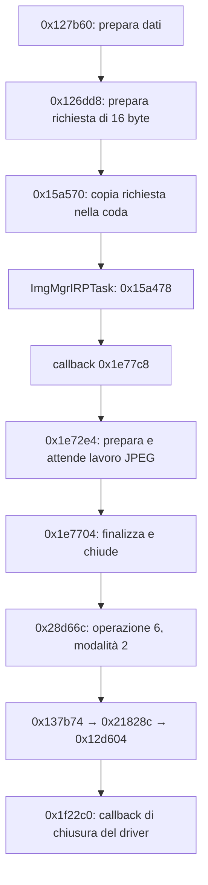

# S33 — elaborazione, scrittura e chiusura del file

Continuazione dell'analisi statica, 17 ottobre 2026. Nessuna comunicazione con la fotocamera.

## Risultato e confine riutilizzabile

È stata ricostruita una catena che invia un lavoro al task ImgMgrIRP, usa il servizio JPEG e raggiunge scrittura e chiusura del file. È un candidato concreto per riutilizzare il motore originale sotto una nuova interfaccia. Il collegamento con il pulsante fisico e con il normale percorso fotografico resta da provare: la sola presenza della catena non esclude modalità speciali o diagnostiche.

**Aggiornamento:** la [verifica dell'ingresso di acquisizione](S33_Ingresso_Acquisizione.md) attribuisce il chiamante `0x163886` al task originale **Take still inside Video**. Il percorso qui descritto documenta quindi un ingresso per la fotografia durante il video, non l'ingresso del pulsante nella modalità fotografica normale.

Le frecce riassumono collegamenti statici, alcuni condizionati. Non costituiscono una traccia di esecuzione né una firma ABI pronta da usare.

## Invio del lavoro

`0x126dd8` costruisce sullo stack quattro parole: `1`, argomento ricevuto, callback `0x1e77c8`, zero. Il puntatore della callback proviene dal letterale `0x126e20`. Chiama `0x15a570` e, se l'invio restituisce zero, attende tramite `0x15a5c8`.

`0x15a570` acquisisce un elemento della coda, copia i 16 byte a elemento + 8, pubblica l'elemento e segnala il worker. Nel task `0x15a478`, il campo a elemento + 16 viene chiamato passando elemento + 8. Questo risolve il passaggio indiretto alla callback `0x1e77c8`.

`0x127b60` prepara una struttura e chiama `0x126dd8` a `0x127de2`. Un chiamante diretto è presente a `0x163886`; la modalità utente di quel chiamante non è stata attribuita. Nessuna conclusione sul pulsante fisico deriva da questi indirizzi.

## JPEG e finalizzazione

La callback `0x1e77c8` esegue più fasi con controlli di errore. Se le fasi precedenti consentono di proseguire, chiama `0x1e72e4`; successivamente raggiunge comunque la finalizzazione `0x1e7704`, conservando lo stato d'errore accumulato.

Dentro `0x1e72e4`, il tratto `0x1e7650–0x1e76fc` pubblica i parametri, invia al task JPEG la callback `0x22ae2c` dal letterale `0x1e78a0`, attende con `0x15a798` e legge l'esito con `0x13b7e4`. È un percorso diverso dalla callback `0x22ab64` esaminata nel rapporto precedente.

La finalizzazione a `0x1e7704`, se lo stato richiede ulteriori dati, prepara i byte `FF D9` nel buffer e passa il buffer alla scrittura. Questo è un indizio coerente con la terminazione JPEG, non una verifica di un file prodotto. Poi richiede la chiusura e controlla l'errore restituito.

## Scrittura e chiusura sono operazioni distinte

Il dispatcher `0x28d66c` usa il primo argomento come selettore. Per il selettore 6 la tabella di salti porta a `0x28d914`: il valore è stato verificato come offset signed a 16 bit moltiplicato per due. Il secondo argomento seleziona, fra gli altri, questi percorsi:

| Modalità | Percorso osservato |
|---|---|
| 1 | `0x28d942 → 0x137b54 → 0x2181f8 → 0x12de3c` |
| 2 | `0x28d920 → 0x137b74 → 0x21828c → 0x12d604` |

La modalità 1 passa buffer, quantità richiesta e un puntatore alla quantità effettiva. Dopo la chiamata il dispatcher confronta quest'ultima con la quantità richiesta e, se differiscono, restituisce il valore `0x700103`. La routine sottostante `0x12de3c` confronta anch'essa il conteggio restituito con la richiesta e gestisce l'errore del file.

La classificazione come scrittura è corroborata da due chiamate a `0x12de3c` nei rami d'errore che referenziano la stringa originale `FILESYS_WriteData` (`0x3adc1d` e `0x3adc7d`). Il servizio arriva a `0x1fa090`, che chiama indirettamente il campo a +`0x18` della struttura driver.

La modalità 2 risolve l'handle e chiama `0x12d604` passando il suo indirizzo. Questa routine verifica l'handle, acquisisce una sincronizzazione, esegue operazioni di controllo e chiama `0x1f22c0`; poi rimuove l'handle dalla tabella e azzera quello del chiamante. In `0x1f22c0` il servizio passa per il campo a +`0x10` della struttura driver. Un altro chiamante di `0x12d604` usa la stringa originale `FILESYS_CloseFile` a `0x3adcb1` nel ramo d'errore.

Il codice di finalizzazione conserva un errore precedente e, se non ne esiste già uno, usa l'errore della chiusura. Nel futuro firmware essenziale questo controllo va mantenuto: fine del lavoro JPEG, scrittura completa e chiusura riuscita sono tre risultati separati.

## Stato della verifica

| Domanda | Stato |
|---|---|
| Come un lavoro raggiunge il task di elaborazione? | Risolto per il pacchetto di 16 byte esaminato |
| Esiste un percorso da elaborazione a finalizzazione e chiusura? | Risolto staticamente per la catena documentata |
| La scrittura controlla quantità ed errori? | Sì, nei percorsi esaminati |
| Quale richiesta del pulsante porta a questa catena? | Irrisolto |
| La chiusura garantisce persistenza sulla SD dopo perdita di alimentazione? | Irrisolto: driver e comandi di controllo non completamente risolti |
| Possiamo già chiamare questi servizi da un'app nuova? | No: ABI completa, inizializzazione e proprietà dei buffer da stabilire |

La prossima analisi deve identificare il percorso utente che prepara la richiesta e risolvere le callback del driver di memoria. Questi due collegamenti servono a definire il comando minimo «scatta e salva» e il momento in cui consentire uno spegnimento normale.

## Evidenze riproducibili

È stato esteso lo [script già esistente](../outputs/trace_s33_jpeg.py), senza duplicare estrazione o verifiche. L'esecuzione verifica 16 blocchi rispetto a dimensioni e SHA-256 del manifest, 19 letterali, tre stringhe diagnostiche, una destinazione della tabella di salti e l'uguaglianza byte per byte degli ELF di analisi. Produce [mappa](../outputs/s33_jpeg_map.json) e [40 finestre disassemblate](../outputs/s33_jpeg_disassembly.txt).

Script, mappa e disassemblaggio sono stati successivamente estesi all'ingresso di acquisizione; il bundle di questo rapporto conserva il passaggio originale di 40 finestre.

Evidenza REA: `ev_1a1ea99c9daf0e1c3ca008974ad857a1d5890ffc8eda68a476f5cdf8ffe17f86`, processo terminato con codice 0 e output non troncato; [bundle](../outputs/s33_rea_storage_evidence.json). Il bundle conserva anche un primo tentativo fallito: un limite superiore tagliava un'istruzione nella finestra di chiusura; è stato corretto prima dell'esecuzione riuscita. Il successo riguarda i controlli statici, non il funzionamento della fotocamera.

Non sono stati misurati tempi o consumi, né prodotte modifiche installabili. Il recupero dopo un firmware errato resta non verificato.

## Continuazione: callback registrate e controlli prima del close

Il [rapporto callback filesystem](S33_Callback_Filesystem_e_Controlli_Close.md) risolve una famiglia registrata con close `0x1F48A4`, write `0x1F4958` e controllo `0x1F56B4`. Nella famiglia, `0x3015` non copia il risultato del worker nello slot di ritorno e `0x3038` sovrascrive il proprio risultato locale. I due controlli nel wrapper close usano handle diversi: l’associazione delle istanze, i backend alternativi e la persistenza SD restano aperti. Verificati 16 hash, 16 finestre e due celle della tabella; nessuna prova hardware.
