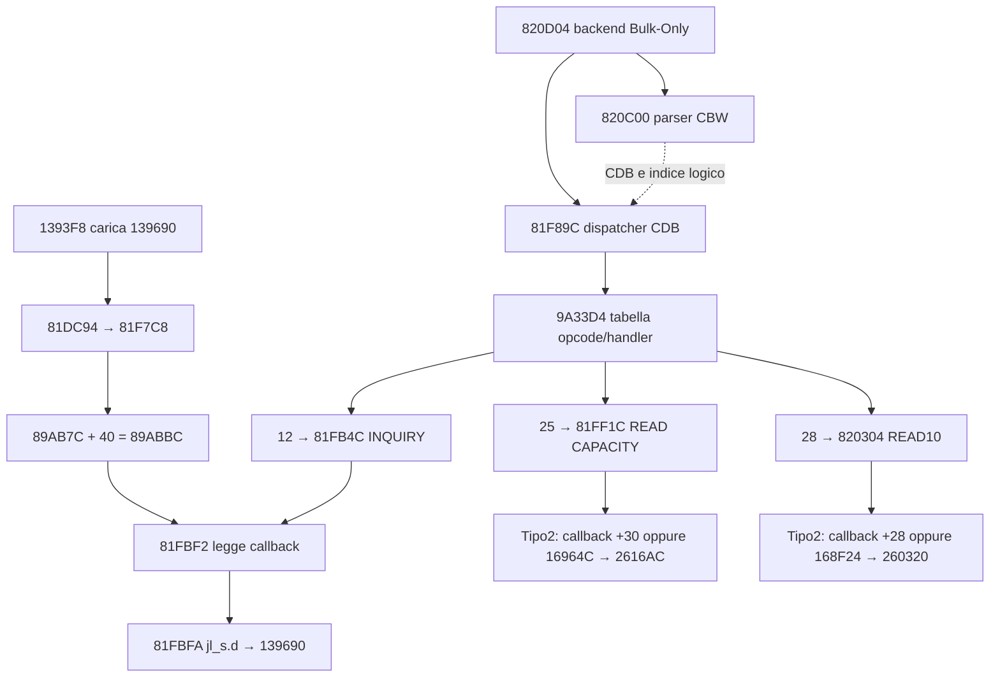

# USB SCSI: callback INQUIRY, dispatcher e capacità dello storage

**Continuazione21ottobre:** [MSDC reale, inizializzatore e preparazione accessoNAND](S33_Accesso_NAND_PC_Inizializzazione_Buffer_e_Nucleo_Sola_Lettura.md). Il nuovo obiettivo utente resta aperto fino all’accesso dalPC alle altre regioni o a un aggiornamento installabile; il vecchio obiettivo minimo sotto non è la conclusione del goal attuale.

21 ottobre 2026 — R0/R3/R4. **La callback memorizzata a `0x89ABBC` viene letta a `0x81FBF2` e chiamata a `0x81FBFA`, dentro il gestore INQUIRY selezionato dall’opcode `0x12`.** Il percorso è verificato staticamente e con istruzioni originali eseguite offline. La tabella SCSI comprende anche READ CAPACITY(10) e READ(10). Il backend NAND contiene un calcolo che, sotto il profilo esplicito descritto sotto, restituisce esattamente **45.056 settori, ultimo LBA `0xAFFF`, 22 MiB**.

L’attivazione di quel profilo nella sessione fisica resta da dimostrare. Nessuna patch, installazione, lettura di settori USB o azione sulla fotocamera è stata eseguita. GNU, firmware e dump canonici sono rimasti invariati. Avanzamento funzionale AkeruOS circa10% e NO-GO invariati.

## Prove e riproduzione

```bash
python3 Python_Trace_Scripts/s33_verify_usb_scsi_callbacks.py
```

- [Script](../Python_Trace_Scripts/s33_verify_usb_scsi_callbacks.py), [indice](../Risultati/USB_SCSI/latest.json), [manifest riuscito](../Risultati/USB_SCSI/20261020T225014Z/verified_evidence.json).
- [37 finestre GNU riancorate](../Risultati/USB_SCSI/20261020T225014Z/gnu_verified.txt), [riferimenti, offset e tabella](../Risultati/USB_SCSI/20261020T225014Z/static_evidence.json), [controlli dei byte eseguiti](../Risultati/USB_SCSI/20261020T225014Z/executed_spans.json).
- [29 casi CBW/INQUIRY](../Risultati/USB_SCSI/20261020T225014Z/cpu_cases.json), [11 casi READ CAPACITY](../Risultati/USB_SCSI/20261020T225014Z/capacity_cases.json), [2 profili NAND](../Risultati/USB_SCSI/20261020T225014Z/geometry_profile_cases.json), [formula e P1IDSTR](../Risultati/USB_SCSI/20261020T225014Z/storage_formula.json).
- [Servizi sostituiti e condizioni di laboratorio](../Risultati/USB_SCSI/20261020T225014Z/fixture.json), [snapshot del verificatore](../Risultati/USB_SCSI/20261020T225014Z/verifier_snapshot.py), comandi, log e tracce nella stessa cartella.

Esito `PASS_ORIGINAL_INQUIRY_CALLBACK_AND_TABLE`: **42 casi**, due esecuzioni GNU senza fault, rispettivamente17.785 e1.858 istruzioni nel profiler. Sono verificati626intervalli di byte, comprendenti finestre e controlli dei PC, con possibili ripetizioni: non626funzioni o626PC distinti. Ogni intervallo confronta firmware originale, payload verificato e MainCode fornito. Il manifest conserva hash degli input e degli strumenti, ricontrollati a fine prova.

Firmware originale29.602.084byte, SHA-256 `1d34e990a8f99019ffa53ca5de785399df863e942739a667ceb314ec6ce62a39`. MainCode SHA-256 `00551af5f4a948f83c3f549a6c5ed3261990143724a3b12de33228c6b4db06b5`. NANDP1 SHA-256 `5bc347e8f00a82c7e386bb0d45d77fa5519582415e79b1fcc97dd9e8526f77a1`.

Le copie `block*_LAB_ONLY.bin` sono immagini RAM per la prova: una sostituzione di8byte nell’ingresso `0x1908DC` conduce al registratore del trasferimento USB. Nessun contenitore firmware modificato è prodotto. I test READ CAPACITY forniscono una callback di geometria nel solo laboratorio; i due test di classificazione eseguono invece i corpi originali `0x25D194` e `0x261478`, con ID espliciti. La produzione completa della geometria `0x2616AC`, che usa anche DSP/AUX, è analizzata staticamente e non eseguita in queste prove.

I tentativi intermedi conservati documentano correzioni al verificatore: operandi PC-relative non immediati, lunghezza trasferimento richiesta uguale alla CDB, riempimento del buffer con zero, allineamento della mappa G e parametro fisico del profilo7. Il risultato finale non richiede modifiche al codice Nikon o al simulatore.

## Call graph e lettore della callback



Gli archi statici non rappresentano una traccia di boot o di traffico reale. Nei test il parser produce CDB/indice e il verificatore chiama esplicitamente il dispatcher, senza eseguire l’intero backend `0x820D04` o il task USB.

| CPU | Offset firmware F | Istruzione / ruolo |
|---|---|---|
| `1393F8` | `000D3EB0` | `ld_s r0,[pcl,0xB4]`, pool1394AC contiene139690 |
| `1393FC` | `000D3EB4` | chiama81DC94 con r1=0 |
| `81F7C8` | `005CC680` | `ld_s r2,[pcl,0x128]`, pool81F8F0 contiene89AB7C |
| `81F7CA` | `005CC682` | `st_s r0,[r2,0x40]` |
| `81F7CE` | `005CC686` | delay slot: `st_s r1,[r2,0x44]` |
| `81FBF0` | `005CCAA8` | `ld_s r15,[pcl,0x12C]`, pool81FD1C contiene89AB7C |
| `81FBF2` | `005CCAAA` | `ld_s r2,[r15,0x40]` |
| `81FBF4/F6` | `005CCAAC/AE` | confronto con zero e salto se nullo |
| `81FBFA` | `005CCAB2` | `jl_s.d [r2]`; delay slot r1=r16, r0=buffer553CDC |

**Confermato:** con puntatore139690 registrato, la CPU raggiunge davvero139690 attraverso81FBFA. r1 è l’indice logico passato al gestore. Il campo vicino `+0x44` è una callback separata per il ramo INQUIRY EVPD: viene letto a81FB86/81FBAA e chiamato a81FBB6. Il registrar gli assegna0 nel caso studiato: non è un parametro opaco della callback `+0x40`.

Il gestore azzera255byte a553CDC, chiama opzionalmente `+0x40`, poi impone byte2=4 e il nibble basso di byte3=2. Pertanto la risposta finale differisce dai36byte prodotti dal solo139690. Se `+0x40` è nullo, salta la chiamata e conserva il buffer iniziale, con questi due ritocchi.

## I quattro riferimenti alla struttura

La ricerca delle parole LE32 nel contenitore ritrova esattamente i quattro riferimenti dell’handoff. La scansione PC-relative ricostruisce74caricamenti candidati dai quattro pool, applicando la scala di `ld.as`; ogni riga è conservata nel JSON.

| Pool CPU | Offset F | Caricamenti candidati | Consumo attribuito |
|---|---|---:|---|
| `81F8F0` | `005CC7A8` |12| registrar+40/+44; callback di stato+18; dispatcher+78; buffer+34/+38 e altri handler locali |
| `81FD1C` | `005CCBD4` |9| INQUIRY legge+40 e+44; altri gestori di risposta/parametri |
| `820510` | `005CD3C8` |36| READ6/READ10/READ12: buffer, dimensione blocco+3C, lettori+0/+C/+28 e callback+20/+58 |
| `8208D0` | `005CD788` |17| continuazione READ12, WRITE10/WRITE12 e sincronizzazione |

Nei consumi attribuiti dei due ultimi pool non emerge un’altra chiamata di `+0x40`: conducono soprattutto ai servizi dati. Non è un’esclusione globale di alias, copie o basi derivate. La parola assoluta89ABBC non compare come LE32 nel contenitore; questo dato da solo non esclude accessi indiretti. La scansione lineare comprende dati e non costituisce un CFG completo.

Un dettaglio di mappatura decisivo: a81FF56, `ld.as r14,[pcl,-142]` risolve **81FD1C** come `(81FF56 & ~3) -142×4`. Il commento GNU81FEC6 usa la scala sbagliata. Lo stesso accade in altre istruzioni `ld.as`; il verificatore usa l’operando e la scala, non il solo commento. Gli offset F sono ricavati dal descrittore del singolo payload, senza offset globale fra sezioni.

## Parser Bulk-Only e dispatcher SCSI

`0x81DC38`, selettore diverso da2/5/6, passa il puntatore `0x820D04` a `0x190BF0`, indice2. Quest’ultimo registra la callback nella tabella puntata dal pool190FD4, base3ADD5C. Questa è registrazione statica del backend; l’invocazione da task/interrupt e l’ordine rispetto al boot non sono stati eseguiti.

Il corpo820D04 richiede una lettura tramite1906B4 e chiama820C00 a820D56. Il parser verifica lunghezza31 e confronta **quattro byte separati55/53/42/43** a820C38..4E. Questo è un riferimento dimostrato alla firma CBW, distinto dal falso positivo testuale GUSBCFG del lavoro precedente. Copia tag, recupera lunghezza little-endian, direzione e indice logico; estrae la CDB dal byte15. La maschera dell’indice è0xF, la lunghezza CDB è mascherata con0x1F: non è qui dimostrata una validazione completa di ogni CBW malformato.

A820E60 il backend chiama81F89C con CDB e indice estratti.81F89C legge l’opcode dal primo byte, cerca18record di8byte a9A33D4 e, dopo i controlli, carica handler dal record+4 e lo chiama a81FA1E. La lunghezza di trasferimento corrente è nel campo globale+74. Il confronto originale81FA90 richiede uguaglianza con la lunghezza della richiesta; restituisce2 se inferiore,1 se superiore,0 se uguale.

| Opcode | Operazione | Handler CPU |
|---|---|---|
| `00` | TEST UNIT READY | `81FAA4` |
| `03` | REQUEST SENSE | `81FAD8` |
| `12` | INQUIRY | `81FB4C` |
| `1A` | MODE SENSE(6) | `81FC5C` |
| `25` | READ CAPACITY(10) | `81FF1C` |
| `28` | READ(10) | `820304` |

Gli altri12record sono pubblicati nel manifest, compresi08/23/2A/A8/AA/9E/5A. Non sono stati eseguiti WRITE, comandi vendor o backend hardware.

I29casi verificano CBW validi con tag10203040, direzioneIN e indice0/1/2; CDB inizialmente avvelenataA5 viene copiata dal parser originale. Allocazioni0/4/36/255, callback presente/assente e cinque richieste INQUIRY invalide o EVPD senza callback controllano risposta, invocazione, trasferimento e SP. La registrazione+40 usa il wrapper originale, ma è il test a richiederla: non prova che il boot la richieda.

## Selezione del dispositivo logico

Il vettore `0x9A3478` contiene record di4byte indicizzati dall’argomento logico. Nei byte iniziali i tre tipi sono0/1/2; i relativi flag differiscono.81F5F8 contiene anche un percorso che ricopia/reordina questi record da un vettore fornito: l’identità dell’indice non deve essere fissata usando soltanto l’ordine statico.

| Tipo letto dal record | READ CAPACITY | READ10 |
|---|---|---|
|0| callback globale+08 | callback globale+00 |
| diverso da0 e2 | callback globale+14 | callback globale+0C |
|2| callback globale+30, altrimenti fallback16964C | callback globale+28, altrimenti fallback168F24 |

La discriminazione è verificata nelle istruzioni81FF54..88 e8203E0..43A. L’inizializzazione dei callback dei tipi0/1 e il loro raccordo completo a DEVSD restano da seguire; non vengono attribuiti dal solo numero.

139690 sceglie il nome **4MP-CAMERA soltanto quando r1=2**, altrimenti4MP-CARD. Il nome è quindi funzione dell’indice, mentre il backend dipende dal tipo contenuto nel record e da eventuali override callback. **Il nome4MP-CARD, da solo, non dimostra che il supporto sia la SD.**

Il riferimento assoluto a1392CC a1392C8 viene passato dal costruttore a81DBB8→190C24, che lo salva nella cella3680CC. Il ramo con argomento6 resta quello del chiamante diretto13950A; per arrivare alla registrazione1393FC occorrono argomento diverso da6 e successo di12A71C. È dunque individuata la registrazione indiretta dell’inizializzatore, ma non è ancora ricostruita la sua successiva invocazione con un argomento effettivo diverso da6.

## READ CAPACITY: origine del numero di settori

L’handler81FF1C, tipo2 senza callback+30, chiama16964C→2616AC. Il wrapper16964C comprende sincronizzazione e gestione dell’esito. I getter25CAEC e25C020 forniscono rispettivamente la geometria **G=50F52C** e la tabella **D=50F420**.

La classificazione25D194, con **input di laboratorioF0**, passa dal salto a25D208 alla classe8 e al ramo25D2FA. I test eseguono l’intero classificatore e il selettore geometria261478: classe8,64pagine/blocco,4settori/pagina,500blocchi nel campoG+8; geometria software500×8×32. Il controllo con input76 produce classe7,32pagine/blocco,1settore/pagina e G+8=1000, pur mantenendo la medesima terna software. Non si possono scambiare i campi fisici con questa terna.

261524 moltiplica la terna e salva **128000** a36B2A0+4.2616AC legge D+E4 a26175A/2617B0 e costruisce un descrittore:

```text
descrittore+08 = riserva iniziale R
descrittore+0C = 128000 − R − u16(D+E4) × u8(G+5) × u8(G+10h)
blocco+10h    = 512 byte, nel profilo considerato
READ CAPACITY ultimo LBA = descrittore+08 + descrittore+0C − 1
```

Gli indirizzi chiave e gli offset del contenitore sono:

| CPU | Offset F | Prova |
|---|---|---|
| `16964C` | `00104104` | wrapper del fallback NAND |
| `2616AC` | `001FC164` | produzione del descrittore |
| `25D208` | `001F7CC0` | selezione classe8 |
| `25D2FA` | `001F7DB2` | campi G del profilo8 |
| `2614DE` | `001FBF96` | terna500/8/32 |
| `26175A` | `001FC212` | lettura halfwordD+E4 |
| `2617DC` | `001FC294` | store del conteggio ridotto a descrittore+0C |
| `81FF8E..9E` | da `005CCE46` | somma+08/+0C e sottrazione1 |

Nel dumpNANDP1, prima tabellaP1IDSTR a offsetraw231A, **D+E4=0144h=324**. Le24copie di244byte sono identiche; il verificatore ne controlla firma, contenuto e hash. Gli offsetraw non sono indirizziCPU.

```text
500 × 8 × 32                  = 128000 settori software
324 × 64 × 4                 = 82944 settori sottratti
128000 − 82944               = 45056 = B000h settori
ultimo LBA                   = AFFFh
45056 × 512                  = 23068672 byte = 22 MiB
```

La riservaR si cancella nella somma usata da READ CAPACITY. Gli11test del formatter originale forniscono descrittori con riserva0/32 e diversi totali; verificano la risposta big-endian, incluso `00 00 AF FF 00 00 02 00`, errori geometria, LBA/PMI e lunghezze7/8/9. La callback di geometria è simulata: questi test provano la formattazione e i controlli, non una letturaNAND.

**Confermato:** classificatore e selettore originali, valore324 nel dump, istruzioni dei prodotti e risposta del formatter. **Probabile:** il volume osservato corrisponde a questo percorso NAND, dato il risultato numerico esatto e il lettore coerente sotto. **Non dimostrato:** IDF0 letto sulla macchina, G runtime, override callback attivi e loro associazione alla singola sessione. Un risultato coincidente non rende unico il profilo hardware.

## READ10: percorso e confini della NAND

820304 decodifica LBA big-endian dai byte2..5 e numero blocchi dai byte7..8. Verifica i buffer, la lunghezza corrente e divide il trasferimento in gruppi di massimo64blocchi. Per tipo2 usa callback+28 oppure, se nullo,168F24. Errori vengono tradotti nei campi sense; non è qui completato un audit di overflow o di ogni combinazione LBA/conteggio.

Il fallback segue:

```text
168F24 → 260320, selettore7
       → 168EAC → 168CEC / 168DB0
       → 25EDDC (posizione e traduzione)
168CEC → 168BBC → 25F338, con controlli lettura/retry
```

260320 gestisce anche estremi parziali dei settori512 nelle pagine da4settori del profilo8. Il selettore7 segue168EAC; non passa dal lettore di partizioni1ED11C dei selettori1..6.

25EDDC usa G+8−D.E4 come limite dei blocchi del primo chip. Con il profilo8: **500−324=176blocchi**,64pagine e4settori:176×64×4=45056.25EE36..3A controlla l’indice chip rispetto aG+4, pari1 nel profilo8; il ramo fuori intervallo restituisce01B00008.25EE60 legge il blocco fisico dalla **LUT50FDC0**, con indice bytechip×2000+blocco×2, e lo conserva nel contesto36B270+1A.

Questa è una LUT del percorso FAT distinta dalla **LUTP1 50E9C0** del [precedente ricostruttore delle partizioni](S33_NAND_Mappa_Logica_e_Ricostruzione_Integrale_Export.md). Il firmware contiene altri lettori/esportatori NAND già studiati, ma non è dimostrato che READ10 USB li selezioni o possa raggiungereBoot/Main/P1. I limiti del percorso ricostruito sono coerenti con il volume ridotto. Inizializzazione della LUT50FDC0, backend SD dei tipi0/1 e traduzione completa fino al trasferimento fisico restano aperti.

## Sessione hardware da22MiB: provenienza e limiti

Il log già presente [20261020T212724Z/observation.json](../Risultati/Hardware/MSDC_Default/20261020T212724Z/observation.json), con [metadati block](../Risultati/Hardware/MSDC_Default/20261020T212724Z/block_metadata.txt), conserva10campioni: Nikon04b0:035d, device29, classe08/06/50, driverusb-storage, sda45056settori e sda145001settori; nome4MP-CARD. È un’osservazione storica riletta, non un nuovo collegamento.

È distinta da device28 delle21:19/21:20UTC, dove la SD compare e poi scompare lasciando capacità0, e dalle precedenti sessioniPTP. Il nuovo handoff riferisce volumeFAT interno e SDassente; i metadati di questa raccolta non certificano filesystem o statoSD e riportano sequenza di collegamento sconosciuta. Queste due caratteristiche restano dichiarazioni fornite, non nuove misure dell’agente. Il nome4MP-CARD non risolve il dubbio.

## Continuazione giustificata

1. Seguire **l’invocazione della callback3680CC** registrata da190C24, con argomento e risultato12A71C, per collegare l’inizializzatore1392CC al ramo MSDC realmente attivo. Il consumatore89ABBC è già trovato: non ripartire dai descrittori.
2. Ricostruire scrittori e configurazione dei record9A3478 e dei callback globali+00/+08/+0C/+14/+28/+30: essi decidono il dispositivo esposto, anche dopo riordinamenti.
3. Seguire acquisizione dell’ID NAND e inizializzazione della LUT50FDC0; confrontare lo stato con il profilo8 senza trasformare inputF0 di laboratorio in osservazione fisica.
4. Per READ10, completare controllo di LBA/conteggio/overflow e propagazione errori fino al lettore NAND; le finestre e i limiti attuali non autorizzano letture di altre regioni o prove sul dispositivo.

L’obiettivo minimo dell’esecuzione, trovare lettura e invocazione di89ABBC, è concluso. La selezione reale del supporto e l’attribuzione definitiva del volume restano esplicitamente parziali; non sono richiesti nuovi builderGNU o modifiche firmware per proseguire staticamente.
